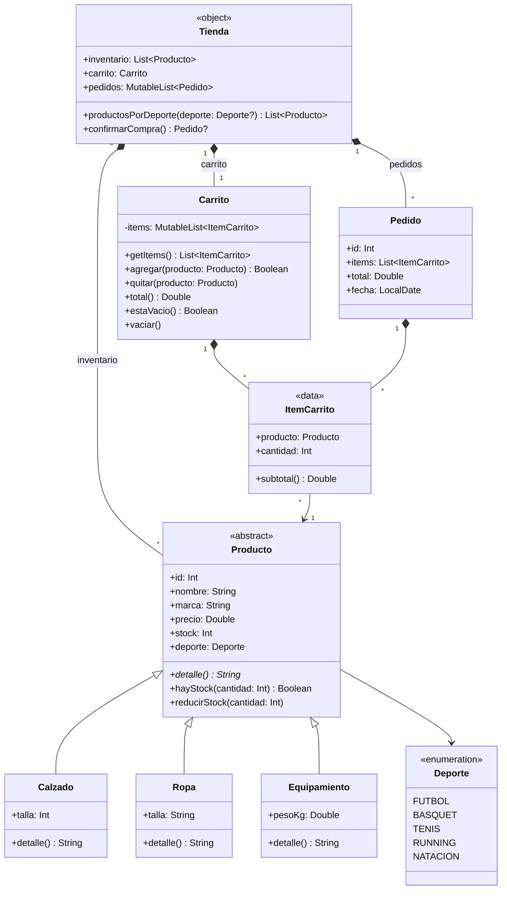

# Tienda de artículos deportivos — App Android (Kotlin)

App sencilla de una tienda deportiva. Sin login, sin base de datos: los datos viven en memoria dentro del singleton `Tienda`, que se inicializa con productos de ejemplo.

## Diagrama de clases



## Reglas de negocio

- `Tienda` es un `object` de Kotlin (singleton) para que ambas pantallas compartan el mismo inventario y carrito.
- `Producto` es `abstract class`; `detalle()` es abstracto y cada subclase devuelve su dato propio ("Talla 42", "Talla M", "1.5 kg"). La UI lo muestra sin saber el tipo concreto.
- `Carrito.agregar(producto)`: suma 1 unidad (crea el item si no existe). Devuelve `false` si la cantidad en el carrito ya alcanzó el `stock` del producto.
- `Carrito.quitar(producto)`: resta 1 unidad; si llega a 0, elimina el item.
- `Tienda.productosPorDeporte(null)` devuelve todo el inventario.
- `Tienda.confirmarCompra()`:
    1. Si el carrito está vacío o algún producto no tiene stock suficiente, devuelve `null`.
    2. Reduce el stock de cada producto.
    3. Crea el `Pedido` con una **copia** de los items y el `total` calculado en ese momento (id = `pedidos.size + 1`, fecha = hoy).
    4. Agrega el pedido a `pedidos`, vacía el carrito y devuelve el pedido.

## Pantallas (Jetpack Compose)

UI en Jetpack Compose + Material 3. Navegación con `NavHost` y dos rutas: `catalogo` (inicio) y `carrito`.

Estilo visual:
- Fondo `#F4F5F7`, tarjetas blancas con borde `#E3E6EA` y esquinas de 16 dp.
- Texto principal `#111418`, texto secundario `#5B6470`.
- Acento naranja `#C2410C`, usado en el botón principal y en el fondo de las miniaturas (`#FFF1E8`).
- Texto "Sin stock" en `#B42318`.
- Precios en formato `Bs 1.210`.

### 1. Catálogo (`CatalogoScreen`)

```
Scaffold
├── topBar: Column (padding 20dp)
│   ├── Text "Tienda Deportiva"          (titleLarge, bold)
│   └── Text "Equípate para tu deporte"  (bodyMedium, gris)
├── content: Column
│   ├── LazyRow (filtros, spacedBy 8dp)
│   │   └── FilterChip × (Todos + cada Deporte)   → selecciona deporte (null = Todos)
│   └── LazyColumn (items = Tienda.productosPorDeporte(seleccionado), spacedBy 12dp)
│       └── ProductoCard
│           └── Card → Row (verticalAlignment = Center)
│               ├── Box 72dp (fondo naranja claro, esquinas 12dp) → Icon según tipo
│               ├── Column (weight 1f)
│               │   ├── Text nombre
│               │   ├── Text "marca · detalle()"
│               │   └── Row → Text precio  +  Text "N en stock" | "Sin stock" (rojo)
│               └── Button "Agregar"  (si stock == 0: deshabilitado con texto "Agotado")
└── bottomBar: Surface → Button ancho completo (naranja, 56dp)
    └── Row (SpaceBetween)
        ├── Row → Icon carrito + Text "Ver carrito"
        └── Text "N artículos · Bs total"           → navega a carrito
```

Comportamiento:
- "Agregar" llama `Tienda.carrito.agregar(p)`; si devuelve `false`, Toast "Sin stock suficiente".
- El contador y el total de la barra inferior se recalculan al agregar.

### 2. Carrito (`CarritoScreen`)

```
Scaffold
├── topBar: Row (verticalAlignment = Center)
│   ├── IconButton ← (volver al catálogo)
│   ├── Text "Mi carrito" (weight 1f)
│   └── Text "N artículos" (gris)
├── content: LazyColumn (items = carrito.items, spacedBy 12dp)
│   └── ItemCarritoCard
│       └── Card → Row
│           ├── Box 64dp → Icon según tipo
│           └── Column (weight 1f)
│               ├── Text nombre
│               ├── Text "detalle() · Bs precio c/u"
│               └── Row (SpaceBetween)
│                   ├── Row con borde (stepper): IconButton −  ·  Text cantidad  ·  IconButton +
│                   └── Text subtotal (bold)
└── bottomBar: Surface → Column (padding 20dp, spacedBy 14dp)
    ├── Row (SpaceBetween) → Text "Total"  ·  Text "Bs total" (grande, bold)
    └── Button "Confirmar compra" (naranja, ancho completo, 56dp; deshabilitado si carrito vacío)
```

Comportamiento:
- `−` llama `carrito.quitar(p)` y `+` llama `carrito.agregar(p)`; si `agregar` devuelve `false`, Toast "Sin stock suficiente".
- "Confirmar compra" llama `Tienda.confirmarCompra()`:
    - Si devuelve un pedido, se muestra un `AlertDialog` con ícono ✓ verde, "Pedido #N confirmado", el total pagado y el botón "Volver al catálogo" (que hace `popBackStack`).
    - Si devuelve `null`, Toast de error.
- Con el carrito vacío, mostrar un `Box` centrado con el texto "Tu carrito está vacío".

## Notas técnicas

- Lenguaje: Kotlin. Moneda: Bolivianos (Bs).
- Cargar 8–10 productos de ejemplo de los tres tipos y varios deportes.
- Al volver del carrito, la lista del catálogo debe refrescarse (el stock pudo cambiar).
- Para que Compose se actualice solo, `Carrito.items` es un `mutableStateListOf<ItemCarrito>()`. Al cambiar la cantidad, se reemplaza el item por `item.copy(cantidad = ...)` en lugar de modificarlo.
